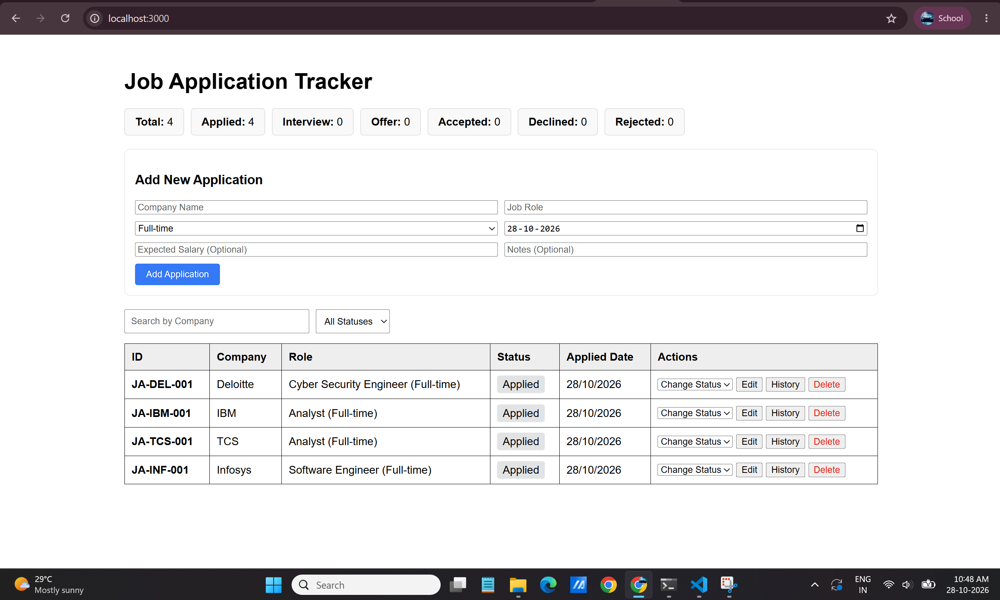
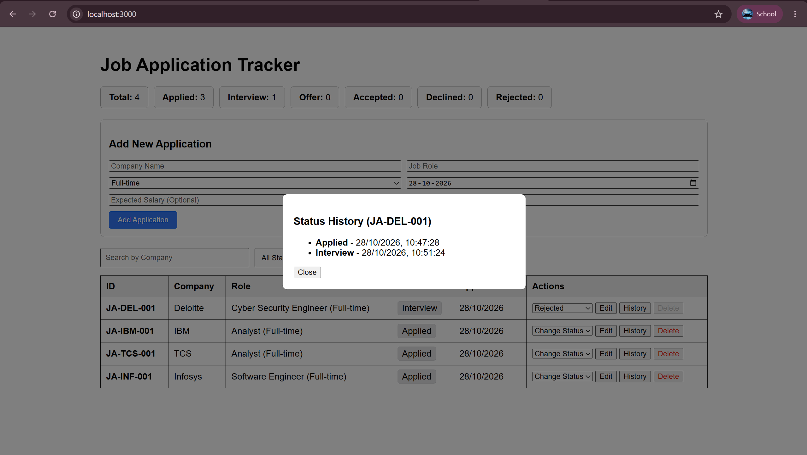

# Job Application Tracker (MERN Stack)

A web application built using the MERN stack (MongoDB, Express, React, Node.js) to record, monitor, and track job application statuses, sequence IDs, and timeline history.

---

## 📡 API Endpoints List

| Method | Endpoint | Description | Status Codes |
| :--- | :--- | :--- | :--- |
| `GET` | `/api/applications` | Fetch all applications (supports search `?company=` and filter `?status=`) | `200`, `500` |
| `POST` | `/api/applications` | Create a new application (auto-generates `JA-<COMP>-XXX` sequence ID) | `201`, `400`, `409` |
| `PUT` | `/api/applications/:id` | Update application details (company, role, job type, salary, notes) | `200`, `400`, `404` |
| `PATCH` | `/api/applications/:id/status` | Advance application status following workflow rules | `200`, `400`, `404` |
| `DELETE` | `/api/applications/:id` | Delete application (Blocked if status is Interview or Offer) | `200`, `400`, `404` |

---

## 🖼️ Application Screenshots

### 1. Main Dashboard

### 2. Status History Modal
